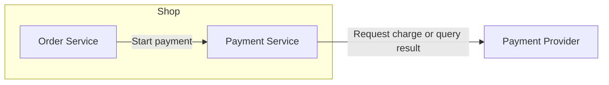
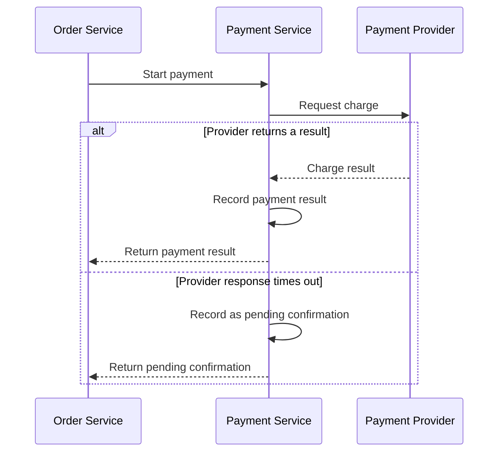

# 4R diagram reference

## Choose the diagram by question

| Question | Mermaid diagram | What to show |
| --- | --- | --- |
| Which roles are connected, and why? | Architecture diagram with `flowchart` | Name the view and level of detail in the title. Put internal roles inside the boundary and external participants outside. Label each directed edge by purpose. Add an interface, protocol, or event when useful. |
| Who acts first, and how does the result return? | `sequenceDiagram`, the Rule default | Participants, message order, triggers, and outcomes. Use `alt` for branches or `loop` for retries when needed. |
| What condition determines the next step? | Flowchart with `flowchart` | Decisions, labeled branches, actions, and outcomes. Name the role that performs each action. |
| How can an object change state? | `stateDiagram-v2` | The object and the role that owns its state, allowed transitions, triggers, and required conditions. |

Arrows in the architecture diagram show relation direction. A call points from caller to recipient. A notification points from sender to recipient. Put return messages in the sequence diagram. Use a short table below the diagram when details such as responsibilities, state ownership, or retry limits need more room.

## Example: shop payments

This system is fictional. **System view at service level.** The shop contains the Order Service and Payment Service. The Payment Provider is external.

| Role | Responsibility |
| --- | --- |
| Order Service | Manages orders and starts payments. |
| Payment Service | Requests charges and records payment state. |

Offer two scenarios. “Start a payment” (recommended) explains how a payment returns a result and handles a provider timeout. “Verify the payment result” explains how the system resolves a payment pending confirmation.

If the user selects “Start a payment,” use a sequence diagram for the response and timeout paths. Reuse the role names from the architecture diagram.

