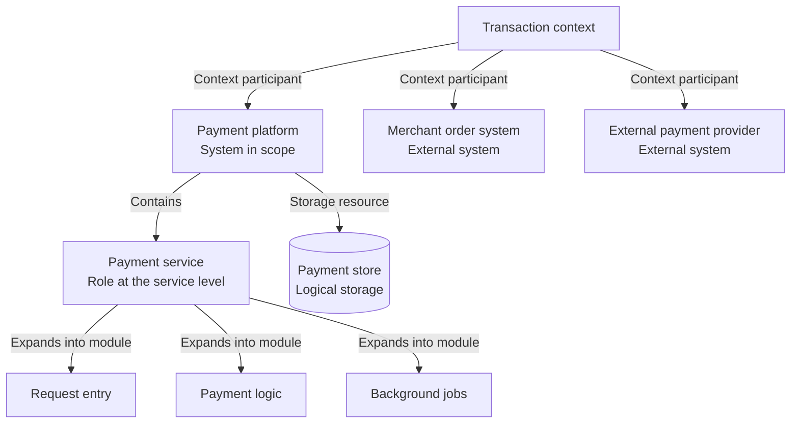

# Rank hierarchy and expansion diagram

Apply the light or dark theme from the [shared diagram design](diagram-design.md).

Rank defines the observation scope and level. Use a hierarchy or nested-boundary diagram to show the parent context, current object, and parts that can be expanded.

## Drawing

- Mark the current boundary and granularity. Hierarchy edges express context membership, composition, or expansion.
- Keep an object's name consistent across diagrams. When expanding a service, retain its mapping to the parent role.
- State perspective separately. Business, system, application, and deployment perspectives can each use different observation levels.

## Template

The fictional payment platform uses service collaboration and logical storage as its current granularity. Modules below the payment service show where it can be expanded.

## Checks

- Can the reader identify the system boundary, current level, and parent context?
- Does each hierarchy edge identify membership, composition, or expansion?
- Can internal modules map to their parent role? Are logical stores distinguished from running database instances?
