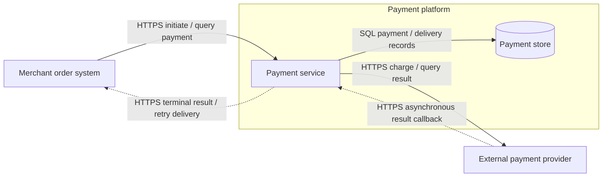

# Relation diagram

Apply the light or dark theme from the [shared diagram design](diagram-design.md).

Relation identifies calls, dependencies, messages, data access, or shared resources between roles. Use directed connections to show both ends and the exchanged content.

## Drawing

- Reuse Role names, identifiers, and boundaries. Label direction and purpose, adding protocols or event names when needed.
- State which relations a diagram shows. This template shows runtime interactions and data access. Draw source dependencies separately.
- Distinguish synchronous requests, asynchronous notifications, and returns. Use two labeled edges for two-way interaction.

## Template

The payment service calls the provider, receives callbacks, and notifies the merchant of terminal results. The payment store represents logical storage.

## Checks

- Does each edge identify the sender, receiver, exchanged content, and interaction style?
- Are call, event, and data directions clear? Are runtime calls distinguished from source dependencies?
- Can key Rule interactions map to these relations or an explicit level expansion?
