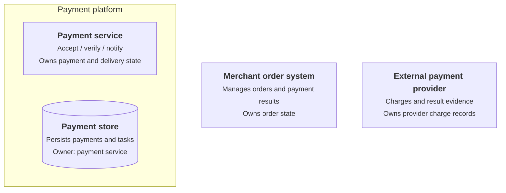

# Role composition and responsibility diagram

Apply the light or dark theme from the [shared diagram design](diagram-design.md).

Role identifies the parts at the current level, their responsibilities, and the state they own. Use a composition or responsibility-group diagram to distinguish internal ownership and external participants.

## Drawing

- Keep Rank's boundary and granularity. Label nodes with names, responsibilities, and key state ownership. Use subgraphs for system membership.
- Put long responsibilities in a table below the diagram. Resource nodes identify who owns their business data.
- Reuse role identifiers in Relation and Rule. Expand calls in the Relation diagram.

## Template

The payment service owns payment state and delivery tasks. The payment store persists them. The merchant order system and provider own order state and charge records respectively.

## Checks

- Do roles match the stated granularity and have clear responsibility boundaries?
- Does every key state have an owner? Is business-data ownership distinct from persistence responsibility?
- Are external roles identified? Can these roles map to relationship and scenario diagrams?
