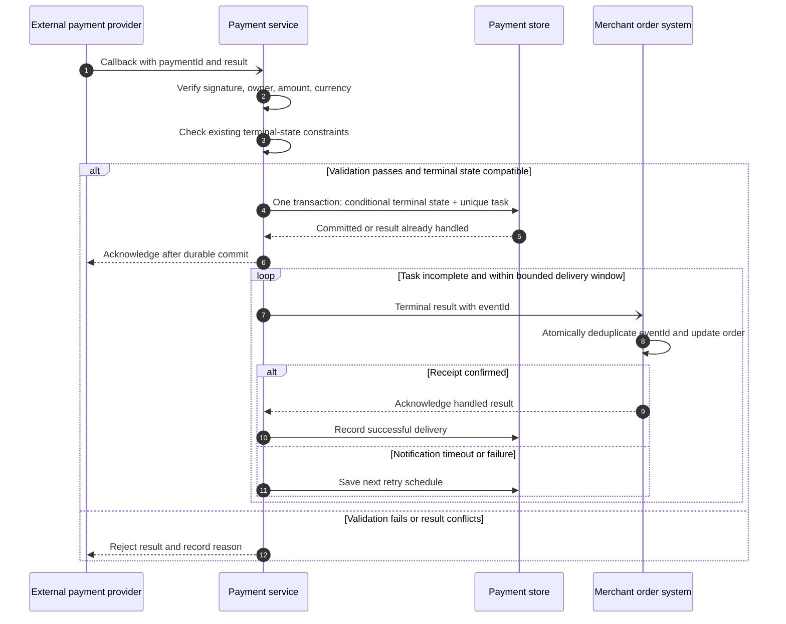
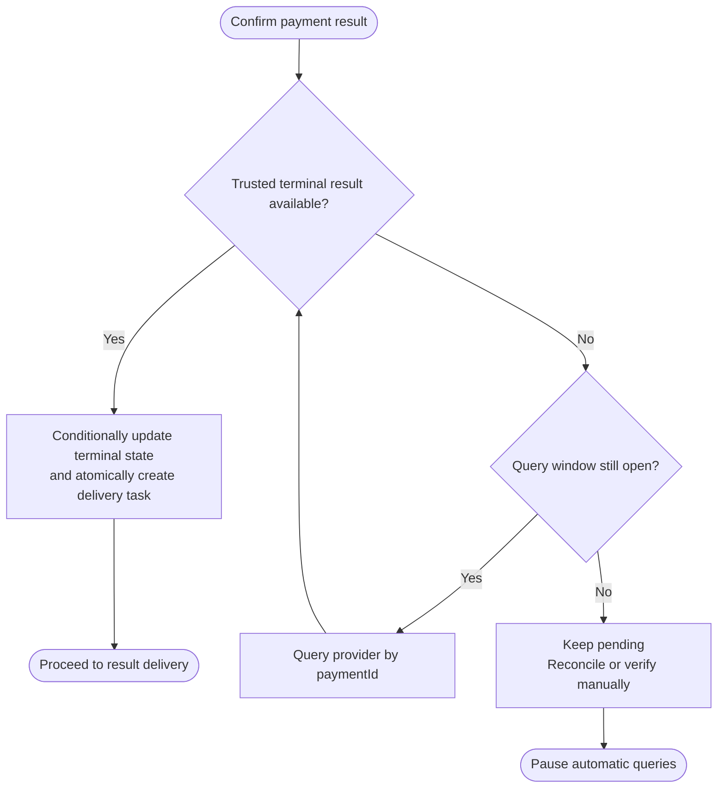
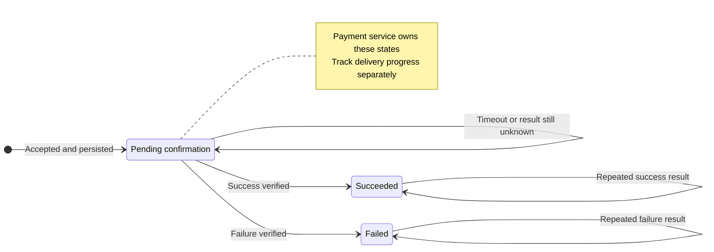

# Rule collaboration diagrams

Apply the light or dark theme from the [shared diagram design](diagram-design.md).

Rule defines the conditions and order of collaboration, state changes, and failure handling. Choose a sequence, conditional flowchart, or state diagram for the question being explained. One R may need several diagrams.

| Diagram | Main concern |
|---|---|
| Business scenario sequence | Who interacts first, how messages return, and where retries or concurrency occur. |
| Conditional flowchart | Which conditions choose the next step and end branches or loops. |
| State diagram | Which states an object owned by a role can occupy and which events permit transitions. |

## Business scenario sequence

The example begins with a provider result callback. The payment service checks its signature, ownership, amount, and currency. It acknowledges the callback after committing terminal state and a unique delivery task together. The merchant atomically deduplicates eventId and updates its order. Delivery timeouts retry with the same eventId.

## Conditional flowchart

The payment service executes this result confirmation flow. Provider queries need an executor, backoff, and a query window. Keep unknown outcomes pending after the window ends and use reconciliation or manual verification.

## State diagram

The payment service owns these states. Transition labels name the triggering conditions. Repeated terminal results cause only one effective change. Investigate conflicting results while retaining the confirmed terminal state. Track notification progress separately. Delivery failure does not change terminal payment state.

## Checks

- Are the trigger, participants, and completion conditions clear? Can participants map to Role?
- Do branches, loops, and transitions name their conditions? Does each failure response have an owner?
- Does timeout preserve uncertainty? Do retries state an executor, bounds, and an exhaustion response?
- Are state updates, atomic commits, duplicates, and reordering clear? Do notes cover idempotency, validation, and terminal-state constraints?
