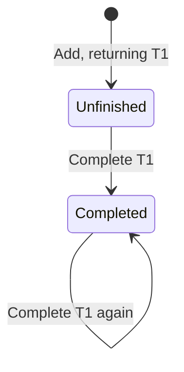

# Reading Specification

Use the reading version by default. Explain behavior with business language, small tables, and minimal diagrams. Expand the [specification notation](spec-notation.md) when implementation or ambiguity requires it. Both forms describe the same behavior without adding decisions.

## Writing principles

Start with user value, then show how a representative scenario delivers it. Preserve necessary state, action conditions and results, query cardinality, and synchronization relations under the [specification notation](spec-notation.md). Remove repetition; add only what understanding or acceptance requires.

Explain as you would to a colleague who knows the business: state conclusions and reasons directly, using concrete individuals to resolve ambiguity. Let principles replace repetitive instructions. Use formulas only for precise relationships and diagrams or tables only to clarify difficulties. Examples do not replace rules; label teaching assumptions and open requirements.

Deliver business specifications without copying these writing principles or review commentary.

## Views and evidence

| Question | Evidence to retain |
| --- | --- |
| Why is this needed? | Purpose, scenario, OP assumptions, and result |
| How does state change? | Inputs, conditions, before/after state, unchanged information, and outputs |
| How is data related? | Named relations, types, cardinalities, and instances |
| How do concepts work together? | Instances, type bindings, and synchronization relations from the [map format](diagram-contract.md) |
| Why are actions ordered? | Source-backed order; show only calls when only calls are established |
| What can be removed? | Requirement-backed purpose dependencies and viable subsets |
| What does the UI do? | Controls to actions, display regions to queries |
| How do implementations or proposals differ? | Source locations, evidence, and behavioral impact |

Returned errors are not automatically states.
Concepts and files need not correspond one-to-one; shared instances do not establish shared storage.
Omit UI views when no UI exists; label unverified queries.
Source excerpts MUST preserve actual text and line numbers; label pseudocode illustrative.

## Concept example

The following example uses teaching assumptions.

### Todo [Owner]

**Purpose**

Remember work to be done and distinguish unfinished from completed work.

**Operational principle**

Lin adds “Submit monthly report,” which appears in the pending list. After completion it disappears from that list, while its task record remains.

**State**

Initially there are no tasks. Each task has the following facts, with exactly one text, owner, and completion flag.

| Fact | Meaning | Example after adding |
| --- | --- | --- |
| Task identity | Distinguishes tasks | T1 |
| Text | Work to be done | Submit monthly report |
| Owner | Associated owner identity | U1 |
| Completion flag | Whether the task is complete | False |

U1 denotes Lin in the example. The concept uses identity only, without depending on names or account attributes.

**Actions**

| Action and inputs | Firing condition | Effects and results |
| --- | --- | --- |
| **Add**: text, owner | No additional condition | Create an unfinished task and return its identity; existing tasks are unchanged. |
| **Complete**: task identity | Task exists | Mark it complete; all other state is unchanged. |



**Queries**

The pending query returns all unfinished tasks with their texts, one binding per task. The owner query returns the specified task's unique owner. Queries are read-only; no match produces an empty result.

## Synchronization example

### NotifyCompletion

**Business decision**

Every completion action initiates a notification to the task's owner.

**Participating concepts**

Todo manages tasks. Notification's send action accepts a recipient identity and message text to initiate a notification. Todo owner identities correspond to Notification recipient identities.

```text
When   Todo's complete action occurs for T1
Query  T1's owner → U1
Then   Initiate a notification to U1: “Task completed”
```

**Boundaries**

No query binding means no notification invocation. Repeated completion initiates another notification even if task state does not change. Initiating a notification does not imply delivery.

**Open issues**

Responses to unknown-task requests and notification failure handling are unspecified.

## Precision expansion

Preserve names, identity mappings, and business meaning when expanding as needed.

| Reading version | Precise version |
| --- | --- |
| Name and type parameters | `concept Name [Type]` |
| Purpose | `purpose` |
| Operational principle | `principle` |
| State | `state` |
| Action conditions and effects | `requires / ensures` within `actions` |
| Query results | Underscore-prefixed queries with `returns` |
| When, Query/If, Then | `when / where / then` |

“Query” obtains values needed downstream and “If” checks conditions; both correspond to `where`. Preserve query cardinality, repeated behavior, and open issues. Changing a condition or result is a requirements change, not format conversion.
