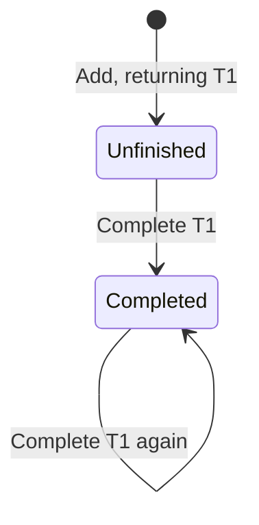

# Reading Specification

Use the reading version by default. Explain behavior with business language, small tables, and minimal diagrams. Expand the [specification notation](spec-notation.md) when implementation or ambiguity requires it. Both forms describe the same behavior without adding decisions.

## Writing principles

- **Purpose explains value.** Say why the functionality is needed, rather than substituting an action name for its purpose.
- **The operational principle shows fulfillment of purpose.** Connect actions to user value through a representative scenario, not an inventory of operations.
- **State supports behavior.** Include only necessary identities, relations, and values, with initial conditions and relevant constraints.
- **Actions specify change.** Separate inputs, firing conditions, results, and unchanged state. A true condition does not guarantee occurrence.
- **Queries are read-only.** State returned values and binding cardinality; an empty result is not automatically an error.
- **Synchronizations specify coordination.** Identify triggers, queries or conditions, subsequent actions, and identity mappings.
- **Examples explain rules.** Use concrete individuals and values from the business context; label teaching assumptions when no confirmed scenario exists. Examples do not replace general rules.
- **Diagrams explain difficulties.** Show state change, identity flow, or causality only where useful, without duplicating a whole table or adding semantics.
- **Keep unknowns open.** Do not invent requirements to fill a layout.

Deliver business specifications without copying these writing principles or review commentary. The following example uses teaching assumptions.

## Concept example

### Todo [Owner]

**Purpose**

Remember work to be done and distinguish unfinished from completed work.

**Operational principle**

Lin adds “Submit monthly report,” which appears in the pending list. After completion it disappears from that list, while its task record remains.

**State**

Initially there are no tasks. Each task has the following facts, with exactly one text, owner, and completion flag.

| Fact | Meaning | Example after adding |
| --- | --- | --- |
| Task identity | Distinguishes tasks | T1 |
| Text | Work to be done | Submit monthly report |
| Owner | Associated owner identity | U1 |
| Completion flag | Whether the task is complete | False |

U1 denotes Lin in the example. The concept uses identity only, without depending on names or account attributes.

**Actions**

| Action and inputs | Firing condition | Effects and results |
| --- | --- | --- |
| **Add**: text, owner | No additional condition | Create an unfinished task and return its identity; existing tasks are unchanged. |
| **Complete**: task identity | Task exists | Mark it complete; all other state is unchanged. |



**Queries**

The pending query returns all unfinished tasks with their texts, one binding per task. The owner query returns the specified task's unique owner. Queries are read-only; no match produces an empty result.

## Synchronization example

### NotifyCompletion

**Business decision**

Every completion action initiates a notification to the task's owner.

**Participating concepts**

Todo manages tasks. Notification's send action accepts a recipient identity and message text to initiate a notification. Todo owner identities correspond to Notification recipient identities.

```text
When   Todo's complete action occurs for T1
Query  T1's owner → U1
Then   Initiate a notification to U1: “Task completed”
```

**Boundaries**

No query binding means no notification invocation. Repeated completion initiates another notification even if task state does not change. Initiating a notification does not imply delivery.

**Open issues**

Responses to unknown-task requests and notification failure handling are unspecified.

## Precision expansion

Preserve names, identity mappings, and business meaning when expanding as needed.

| Reading version | Precise version |
| --- | --- |
| Name and type parameters | `concept Name [Type]` |
| Purpose | `purpose` |
| Operational principle | `principle` |
| State | `state` |
| Action conditions and effects | `requires / ensures` within `actions` |
| Query results | Underscore-prefixed queries with `returns` |
| When, Query/If, Then | `when / where / then` |

“Query” obtains values needed downstream and “If” checks conditions; both correspond to `where`. Preserve query cardinality, repeated behavior, and open issues. Changing a condition or result is a requirements change, not format conversion.
