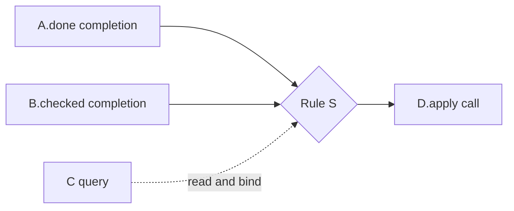

# Views and notation

Use one project scenario, real names/values, and the smallest view that answers the question.
State omitted data, cardinalities, instances, and rules.

## Choose a view

| Question | Required content |
| --- | --- |
| What is this for? | Purpose, participating concepts, and an operational principle with assumptions and useful result |
| What changes? | Before/after state, inputs, condition, unchanged information, and outputs |
| What is related? | ER view with named relations, cardinalities, subsets, and examples |
| How are concepts combined? | Type bindings, shared/separate instances, and syncs |
| Why does an action follow? | Rule node, all required completions, query bindings, parameter sources, and calls |
| What can be removed? | Requirement-backed product dependencies and viable subsets |
| What does the UI do? | Controls mapped to actions; display regions mapped to queries |
| Where is it implemented? | Files, symbols, current lines, and paired explanations |
| What should change? | Current/proposed view or diff, evidence, benefit, cost, and behavioral impact |

An operational principle explains purpose, not every behavior or button click. State records what
behavior needs. For a few states, use transitions between explicit states/predicates; returned errors
are not automatically states. Use relations and action tables for complex state.

## Label relationships

| Mark | Meaning |
| --- | --- |
| Unarrowed solid line | Named state relation with cardinality |
| Solid arrow inside a concept | Action effect on state |
| Dashed connection | Sync participation |
| Dotted connection | Type binding |
| Named pin | Dynamic subset |

This legend is for integrated concept views. Label call, sequence, and product-dependency views
separately. Product dependence means retaining one function requires another; calls/triggers do not prove it.

A and B match together in one flow; Q supplies bindings. This proves no call order, simultaneous
completion, or transaction. Show sequences only for established order. If source proves only calls,
draw calls and mark unknown semantics.

## Explain and verify

Pair each action with its state change, output, and purpose, and each source line with an explanation.
Label pseudocode illustrative. Concepts and files need not match one-to-one; logical instance sharing
does not prove shared storage. Several UI refreshes may only reevaluate a query. Mark unverified
queries, omit UI views without a UI, and check support for the operational principle.

Daniel Jackson writes, "The concept stands by itself, without reference to other concepts."
Use [independence](https://essenceofsoftware.com/tutorials/concept-basics/modularity/) when a change
puts another concept's meaning inside a definition. Also check purpose, complete behavior, familiarity,
and preservation of meaning in composition.

Show enough context to expose ownership and ordering. Keep details connected to the overview and
finish with the scenario result. A simulation explains a proposal; it does not verify runtime correctness.
