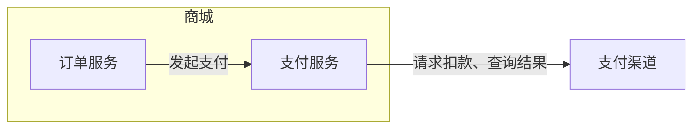
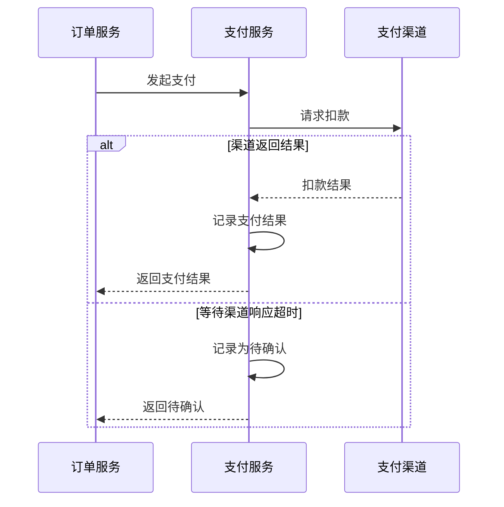

# 4R 图示参考

## 按问题选图

| 要回答的问题 | Mermaid 图型 | 图里放什么 |
| --- | --- | --- |
| 哪些角色相连，为什么？ | 架构图 `flowchart` | 标题写视图和粒度。框内放本层角色，框外放外部参与者。有向边写用途，必要时补接口、协议或事件。 |
| 谁先做什么，结果如何返回？ | 时序图 `sequenceDiagram`，Rule 默认 | 参与者、消息顺序、触发条件和结果。需要时用 `alt` 表示分支，用 `loop` 表示重试。 |
| 什么条件决定下一步？ | 流程图 `flowchart` | 判定条件、分支标签、动作和结束结果。标明各动作由谁执行。 |
| 一个对象如何改变状态？ | 状态图 `stateDiagram-v2` | 对象及其状态的负责角色、允许的迁移、触发事件和必要条件。 |

架构图的箭头表示关系方向。调用边从发起者指向接收者，通知边从发送者指向接收者。调用的返回值放在时序图里。职责、状态归属或重试上限等信息较长时，用图下的短表补充。

## 示例：商城支付

这是一个虚构系统。**系统视图，服务粒度。** 边界是商城，内部角色是订单服务和支付服务，外部参与者是支付渠道。

| 角色 | 职责 |
| --- | --- |
| 订单服务 | 管理订单，发起支付。 |
| 支付服务 | 请求渠道扣款，记录支付状态。 |

可推荐两个场景供用户选择。「发起支付」（推荐）说明一次支付如何返回结果，以及渠道超时时如何处理。「查证支付结果」说明如何确认一笔待确认的支付。

用户选择「发起支付」时，用时序图表达正常返回与超时。角色名沿用架构图。

