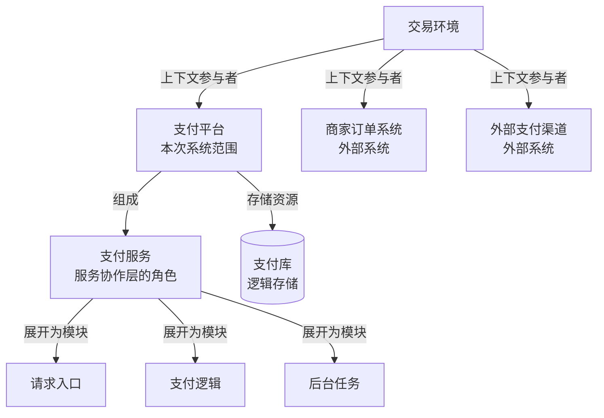

# Rank 的层级与展开图

画图时应用[共享图示设计](diagram-design.md)中的明暗主题。

Rank 说明本次观察哪个范围、看到哪一级。用层级图或嵌套边界图表达上层上下文、当前对象与可展开部分。

## 画法

- 标明本次边界与当前粒度。层级边只表示上下文归属、组成或展开。
- 同一对象在不同图中保持同名。展开服务时，保留它与上层角色的对应关系。
- 视图类型单独说明。业务、系统、应用和部署各自都可以选择不同的观察层级。

## 模板

虚构支付平台以服务协作及逻辑存储为当前粒度。支付服务下方的模块表示可进一步展开的范围。

## 检查

- 能否找到系统边界、当前层级和上层上下文？
- 每条层级边是否明确表示归属、组成或展开？
- 下层模块能否对应上层角色？是否区分逻辑存储与数据库运行实例？
