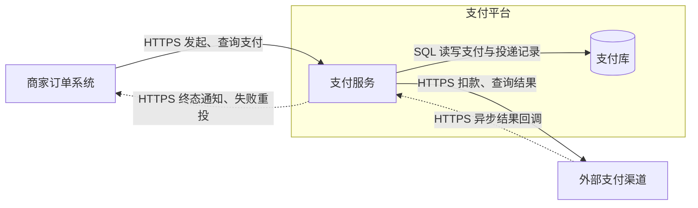

# Relation 的角色关系图

画图时应用[共享图示设计](diagram-design.md)中的明暗主题。

Relation 说明角色之间存在哪些调用、依赖、消息、数据访问或共享关系。用有向关系图表达两端角色及交换内容。

## 画法

- 复用 Role 的名称、标识和边界。连线标注方向、用途，必要时注明协议或事件名。
- 一张图先声明关系类型。本模板画运行交互与数据访问，源码依赖单独成图。
- 同步请求、异步通知和返回值分别表达。双向交互用两条有含义的边。

## 模板

支付服务调用渠道并接收回调，再把终态通知商家。图中的支付库是逻辑存储。

## 检查

- 每条边能否说明由谁联系谁、交换什么、采用什么交互方式？
- 调用方向、事件方向、数据方向是否明确？是否区分运行调用与源码依赖？
- Rule 中的关键交互能否对应这些关系或明确的层级展开？
