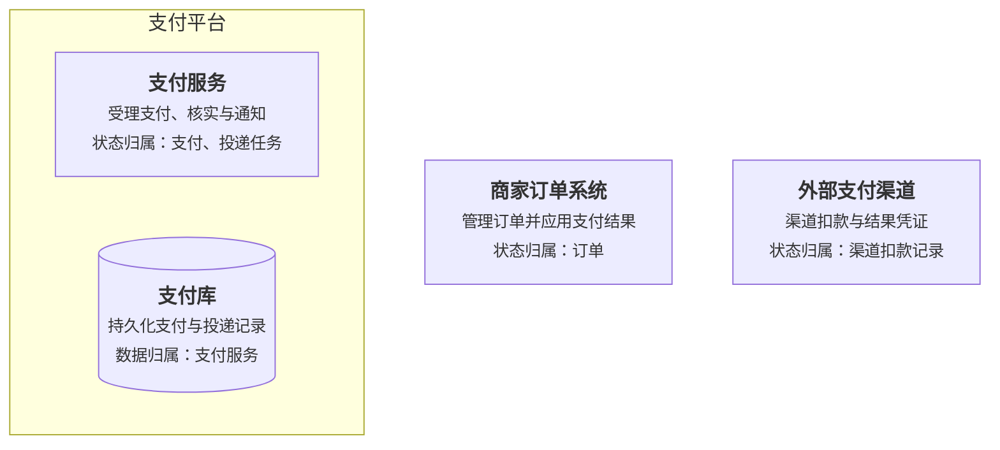

# Role 的组成与职责图

画图时应用[共享图示设计](diagram-design.md)中的明暗主题。

Role 说明当前层级有哪些组成部分、各自负责什么，以及状态由谁持有。用组成图或职责分组图列出角色，标明内部归属与外部参与者。

## 画法

- 沿用 Rank 的边界和粒度。节点写名称、职责及关键状态归属，子图表示所属系统。
- 职责较长时，图下补职责表。资源节点说明谁拥有其业务数据。
- 角色标识供 Relation 与 Rule 复用，调用关系在 Relation 图中展开。

## 模板

本例的支付服务拥有支付状态与投递任务，支付库负责持久化。商家订单系统和渠道分别拥有订单状态与扣款记录。

## 检查

- 各角色是否处于已声明的粒度，职责边界是否清楚？
- 关键状态是否有明确所有者？是否区分业务数据归属与存储职责？
- 外部角色是否标明？这些角色能否在关系图和场景图中找到对应？
