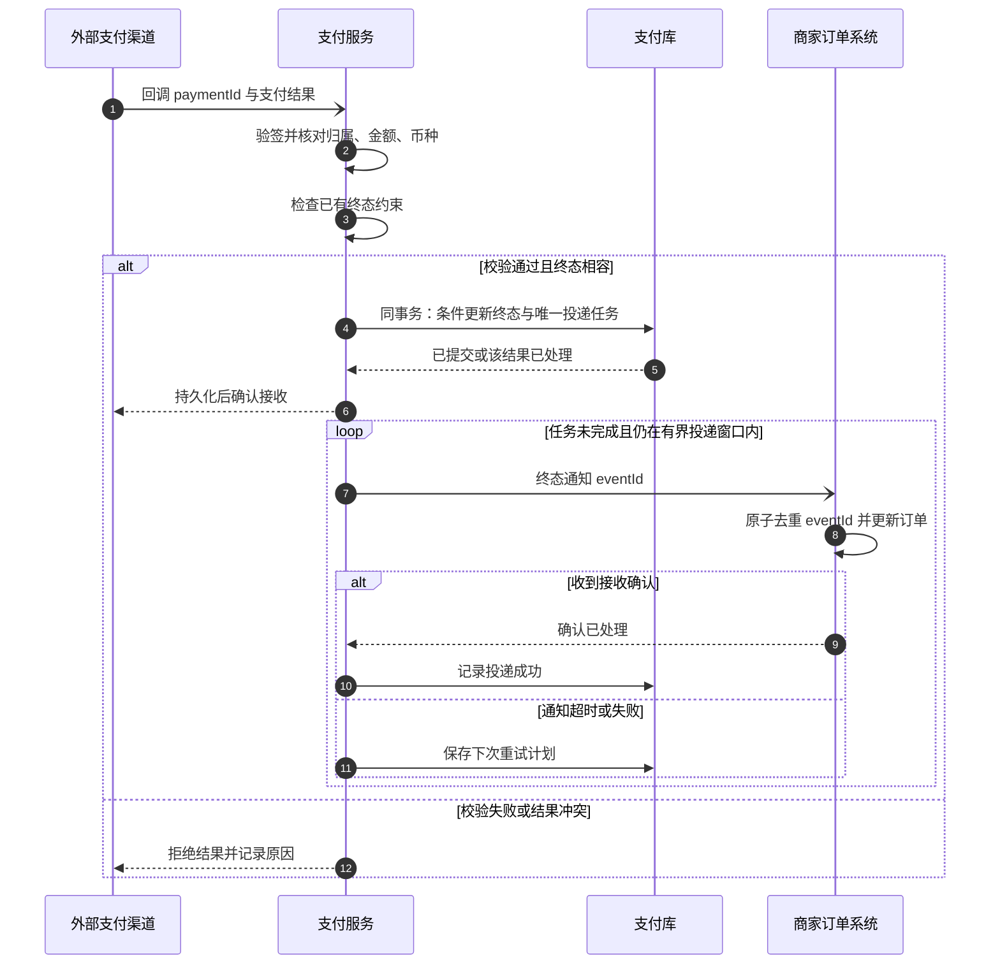
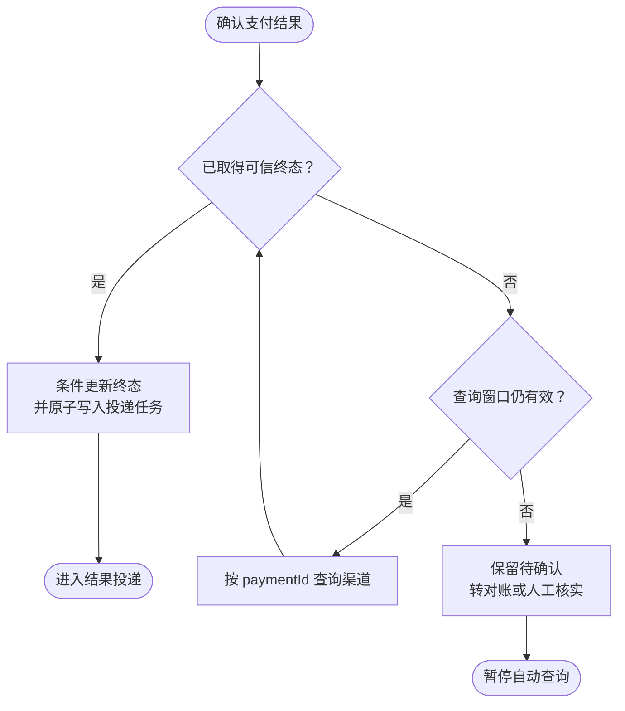
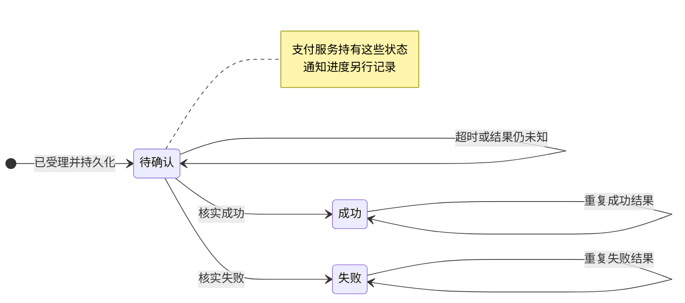

# Rule 的协作规则图

画图时应用[共享图示设计](diagram-design.md)中的明暗主题。

Rule 说明角色按什么条件和顺序协作，怎样改变状态、处理异常。按所表达的问题选择时序图、条件流程图或状态图，一个 R 可以使用多张图。

| 图法 | 主要表达 |
|---|---|
| 业务场景时序图 | 谁先与谁交互，消息如何返回、重试或并发。 |
| 条件流程图 | 什么条件决定下一步，分支和循环何时结束。 |
| 状态图 | 某个角色持有的对象可以处于什么状态，什么事件允许迁移。 |

## 业务场景时序图

本例从渠道结果回调开始。支付服务验签，并核对支付归属、金额与币种。终态与唯一投递任务同事务提交后才确认回调。商家按 eventId 原子去重并更新订单，通知超时继续使用同一 eventId 重投。

## 条件流程图

支付服务执行此结果确认流程。渠道查询需有执行方、退避和查询窗口。窗口耗尽后保留待确认，并转入对账或人工核实。

## 状态图

这些状态由支付服务持有。图中的迁移标签说明触发条件，重复终态只产生一次有效变更。冲突结果进入核查，已确认终态保持不变。通知进度另行记录，投递失败不修改支付终态。

## 检查

- 场景的触发条件、参与者、结束条件是否明确？参与者能否对应 Role？
- 分支、循环、状态迁移是否写明条件？失败处理是否有负责角色？
- 超时是否保留未知结果？重试是否说明执行方、边界和耗尽后的处理？
- 状态更新、原子提交、重复与乱序处理是否清楚？图下是否补足幂等、校验和不可倒退等约束？
