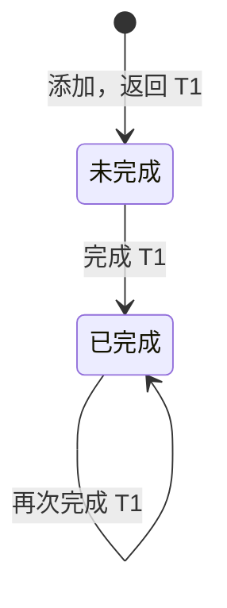

# 阅读版规格

默认使用阅读版。用业务文字、少量表格和最小图示说明行为；需要实现或核对歧义时，按[规格记法](spec-notation.md)展开精度版。两版表达同一行为，不新增决定。

## 编写原则

先说用户所得，再用代表性过程解释如何得到它。按[规格记法](spec-notation.md)保留必要的状态、动作条件与结果、查询基数和同步关系；删除重复说明，只补影响理解或验收的缺口。

像向熟悉业务的同事解释：直说结论及原因，用具体对象消除歧义。原则能统摄的内容不逐项铺陈；公式仅用于准确表达关系，图表仅用于解释难点。示例不代替规则，教学设定与未决需求须明确标注。

实际交付只输出业务规格，不复制编写原则或审阅批注。

## 视图与证据

| 问题 | 必须保留的内容 |
| --- | --- |
| 为什么需要？ | 目的、场景、OP 前提与结果 |
| 状态如何变化？ | 输入、条件、前后状态、不变内容与输出 |
| 数据怎样关联？ | 具名关系、类型、基数与实例 |
| 概念怎样协作？ | 实例、类型绑定及[图格式](diagram-contract.md)规定的同步关系 |
| 动作为何有先后？ | 有来源依据的时序；只证明调用时只画调用 |
| 什么可以移除？ | 有需求依据的目的依赖与可用子集 |
| UI 做了什么？ | 控件到动作、显示区域到查询的映射 |
| 实现或方案有什么不同？ | 源码位置、证据及行为影响 |

错误返回不自动成为状态。
概念与文件不必一一对应，共享实例不证明共享存储。
无 UI 时不画 UI；未验证查询明确标注。
源码片段 MUST 保留真实文本与行号，伪代码注明示意。

## 概念示例

以下为教学设定。

### 待办 Todo［负责人］

**目的**

记录需要完成的工作，区分未完成与已完成。

**运作原理**

小林添加“提交月度报告”后，它出现在未完成列表；完成后，它从列表消失，任务记录仍保留。

**状态**

初始没有任务。每个任务具有以下事实；文本、负责人和完成标记各有一个值。

| 事实 | 含义 | 添加后的实例 |
| --- | --- | --- |
| 任务身份 | 区分任务 | T1 |
| 文本 | 要完成的工作 | 提交月度报告 |
| 负责人 | 对应的负责人身份 | U1 |
| 完成标记 | 是否已经完成 | 否 |

U1 在示例中指小林。概念仅使用身份，不依赖姓名或账户属性。

**动作**

| 动作与输入 | 发生条件 | 效果与结果 |
| --- | --- | --- |
| **添加**：文本、负责人 | 无额外条件 | 创建未完成的新任务，返回其身份；已有任务不变。 |
| **完成**：任务身份 | 任务存在 | 标记为已完成；其余状态不变。 |



**查询**

未完成任务查询返回全部未完成任务及文本，每任务一项；负责人查询返回指定任务的唯一负责人。查询只读，无匹配时为空。

## 同步示例

### 完成通知 NotifyCompletion

**业务决定**

每次完成任务，都向该任务的负责人发起通知。

**参与概念**

Todo 管理任务；Notification 的发送动作接收收件人身份与消息文本，发起通知。Todo 的负责人身份对应 Notification 的收件人身份。

```text
当  Todo 的完成动作发生，任务为 T1
查  T1 的负责人 → U1
则  向 U1 发起通知：「任务已完成」
```

**边界**

查询无匹配时不发起通知。重复完成仍会再次发起通知，即使任务状态没有变化。发起通知不等于送达。

**未决**

未知任务请求如何响应、通知失败如何处理，尚未规定。

## 精度展开

保留相同名称、身份对应与业务含义，按需展开。

| 阅读版 | 精度版 |
| --- | --- |
| 名称与类型参数 | `concept Name [Type]` |
| 目的 | `purpose` |
| 运作原理 | `principle` |
| 状态 | `state` |
| 动作条件、效果 | `actions` 中的 `requires / ensures` |
| 查询结果 | 以下划线命名的查询与 `returns` |
| 当、查／且、则 | `when / where / then` |

“查”取得后续所需的值，“且”检查条件，均对应 `where`。精度版保留查询基数、重复行为及未决项；改变条件或结果属于需求变更，不是格式转换。
