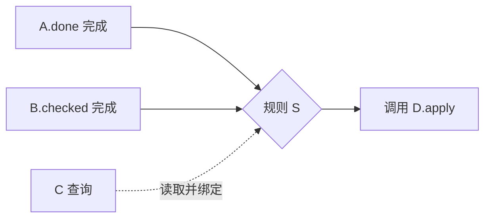

# 视图与记法

沿用一个项目场景、真实名称和值，选择能回答问题的最小视图，说明省略的数据、基数、实例与规则。

## 按问题选图

| 问题 | 必要内容 |
| --- | --- |
| 有什么用？ | 目的、参与概念，以及有前提和有用结果的运作原理 |
| 改变了什么？ | 前后状态、输入、条件、未变部分与输出 |
| 哪些信息有关联？ | ER 图，标关系名、基数、子集与实例 |
| 怎样组合？ | 类型绑定、共享/独立实例与同步 |
| 为什么有后续动作？ | 规则节点、全部完成条件、查询绑定、参数来源与调用 |
| 能移除什么？ | 有需求依据的产品依赖与可行子集 |
| 界面做了什么？ | 控件对应动作，显示区域对应查询 |
| 在哪里实现？ | 文件、符号、当前行号与对应解释 |
| 应怎样修改？ | 现状/建议图或 diff，附证据、收益、代价与行为影响 |

运作原理解释目的，不穷举行为或按钮操作。状态只记录行为需要的信息。
少量状态可用转换图，节点须是状态或明确条件，错误返回不自动成为状态。复杂状态用关系图和动作表。

## 标明关系

| 图形 | 含义 |
| --- | --- |
| 无箭头实线 | 具名状态关系与基数 |
| 概念内实线箭头 | 动作对状态的效果 |
| 虚线 | 同步参与关系 |
| 点线 | 类型绑定 |
| 具名图钉 | 动态子集 |

此图例用于综合概念图，调用、时序与产品依赖图另标含义。
产品依赖表示保留某功能需要另一功能，调用/触发不能证明依赖。

A 与 B 在同一 flow 共同匹配，Q 提供绑定，不证明调用顺序、同时完成或事务。
已有顺序证据时才画时序图。源码只证明调用时就画调用，并标未知语义。

## 解释与核验

动作配状态变化、输出与用途，源码逐行配解释，伪代码标为示意。
概念与文件不必一一对应，共享实例不证明共享存储。多次界面刷新可能只是查询重算。
标出未核实查询，无界面就省略界面图，并检查是否支持运作原理。

Daniel Jackson 写道，"The concept stands by itself, without reference to other concepts."
修改把另一概念含义带入定义时，按[独立性](https://essenceofsoftware.com/tutorials/concept-basics/modularity/)检查。
同时核对目的、完整行为、熟悉性和组合中的含义保持。

保留足够上下文以说明归属与顺序，细节能回到总览，最后说明场景结果。模拟解释方案，不验证运行正确性。
