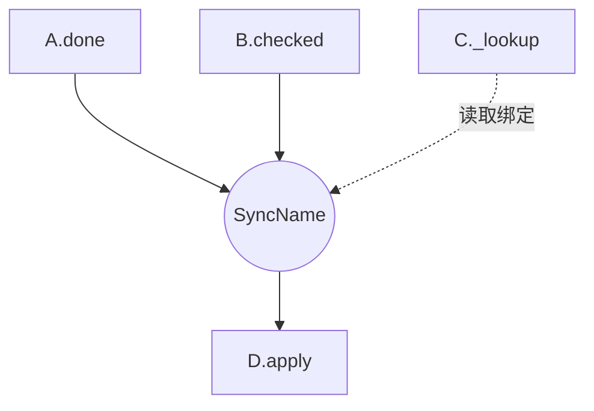

# 架构地图

从 CONCEPT、SYNCS、PIPELINE、总体 PRD 与暂存索引派生导航。
无规格时报告覆盖缺口，不生成空图。地图不是权威契约，也不证明代码正确。

| 视图 | 来源与含义 |
| --- | --- |
| 概念索引 | 目的及当前规格链接。 |
| 同步图 | 每规则一节点，全部 when 共同连入，then 连出，where 单独读取；保留结果分支与对象关联。 |
| 产品依赖 | 只取总体 PRD 中的需求依据，不从同步或代码边推导。 |
| 数据流 | PIPELINE 中的拥有者、来源、阶段、输出与公开读写接口。 |
| 覆盖 | 节点来源、内部缺规格、外部引用与未核实项。 |

权威来源只计一次。保留未解析和跨范围引用，内部缺规格不能标为外部参与者。
按内容重建，有变化才写，保留人工备注。只有完整来源集合与内容指纹才能支持跳过重建，mtime 不足以证明。

## 输出示例

````markdown
# architecture: <项目>

> Generated by `software-concept-architect-guardrails-cn map` on <日期>
> Scope: <目录、来源清单或索引、规格版本>

## relationship graph



A.done 与 B.checked 共同匹配；query 只绑定值。

## dependency matrix

| Concept | Requires (extrinsic) | Required by |
| --- | --- | --- |
| A | B | — |
| B | — | A |

## data flow paths

- <有规格依据的路径、含义、来源链接>

## coverage

- <已读规格、未建规格的内部引用、范围外目标、未核实来源>
````

使用稳定 ASCII ID、转义标签，并按名称和路径排序。视觉分组不创造架构层次。
保留依赖组全部成员、排除动作与跨范围边，循环标控制依据。
报告节点/规则数、关系变化与缺口，未枚举代码时只报规格计数。图的含义不得强于来源。
